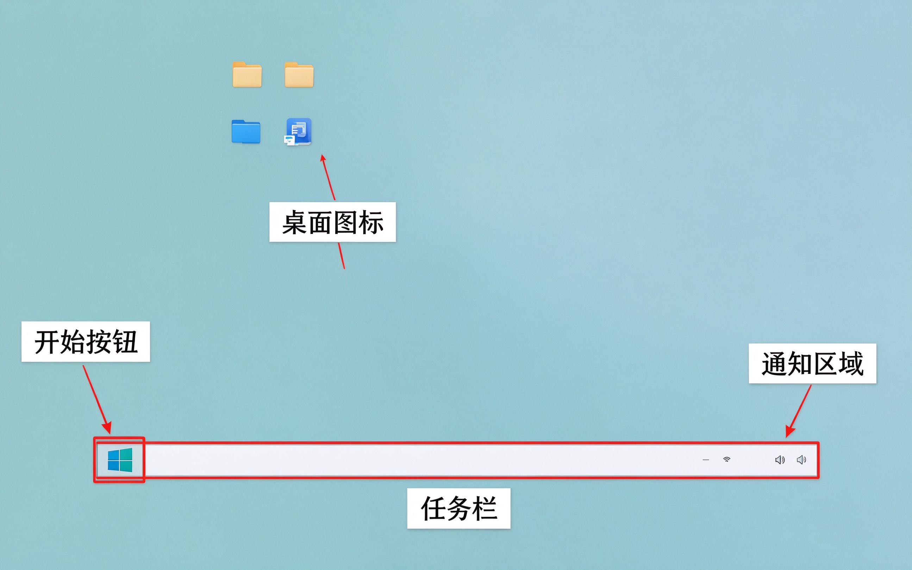

# 第1课：认识 Windows 桌面

> **这节课我们学什么？**
> 打开电脑后看到的第一个画面叫"桌面"。这节课只做一件事：认识桌面上每个区域的名字和作用。不用操作任何东西，先看懂就行。

## 什么是桌面？

按下电脑电源，等它启动完成，最后看到的这个画面，就叫 **桌面**。

它就像你家里的书桌——上面放着你常用的东西，下面是你操作的台面。

## 桌面上有四个关键区域

### 1. 开始按钮（左下角）

左下角那个像四格窗户的图标，就是 **开始按钮**。

它是电脑的"总入口"——所有软件、设置、文件，都从这里开始找。

> [!tip] 记住位置就行
> 现在不用点开它，下节课我们再学怎么用。你只要记住：**所有东西都从左下角开始找**。

### 2. 任务栏（底部整条）

屏幕最下面这一条蓝色的横条，叫 **任务栏**。

它就像书桌上的"常用工具架"——你正在用的软件、常用的软件，都放在这里。

你可以在这里：
- 切换正在打开的窗口
- 看到时间和日期
- 找到正在运行的软件

### 3. 桌面图标（中间区域）

桌面中间那些小图片，下面带着文字，叫 **桌面图标**。

每个图标代表一个软件或者一个文件夹。就像你书桌上贴的标签——看到标签就知道里面是什么。

> [!note] 小提示
> 刚买回来的新电脑，桌面上图标很少，这是正常的。以后我们会把常用的软件放上来。

### 4. 通知区域（右下角）

任务栏最右边，显示时间、音量、网络图标的地方，叫 **通知区域**。

它就像书桌上的"小闹钟"——提醒你电脑的状态：有没有网、声音大不大、现在几点。

## 今天的小练习

不用打字，不用点鼠标，只做一件事：

> [!example] 找一找
> 看着你的电脑桌面，用手指（或者鼠标）依次指出：
> 1. 开始按钮在哪里？
> 2. 任务栏在哪里？
> 3. 桌面图标在哪里？
> 4. 右下角的时间在哪里？

四个都能指对，这节课就过关了。

---

**下节课预告：** 我们学习怎么用鼠标——移动、点击、双击，这是所有电脑操作的基础。
