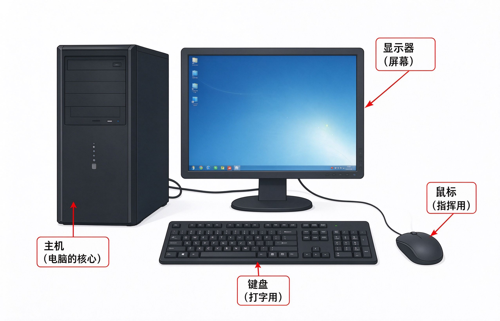

# 第1课：认识电脑的各个部件

一套台式电脑，主要由四个东西组成。先认清楚哪个是哪个，后面才不会搞混。

## 主机

那个比较大的黑色方盒子，就是 **主机**。

它是电脑的核心——所有计算、存储都在里面。平时不用打开它，你只需要知道：电源按钮一般在主机正面或者上面。

主机后面有很多线，插着电源、显示器、键盘、鼠标。这些线**不要随便拔**，认识就行。

## 显示器

就是那个屏幕，跟家里的电视屏幕差不多。

电脑工作的画面都显示在这里。显示器底部有电源开关，旁边可能有几个按钮用来调亮度。

## 键盘

跟打字机的键盘差不多，一排一排的按键。

用来输入文字、数字、命令。后面会专门讲怎么用键盘。

## 鼠标

那个拿在手里、可以移动的小设备。

它是你指挥电脑的工具——移动光标、选择东西、点按钮，全靠它。后面会专门讲鼠标的用法。

## 电源线

每样东西都需要插电。主机和显示器各有一根电源线，插在墙上的插座或者插线板上。

> [!warning] 不要乱拔线
> 主机后面的线很多，每根都插在固定的位置。认识就好，不要拔下来试——插回去的时候容易插错。

---

**下一节：开机和关机**
