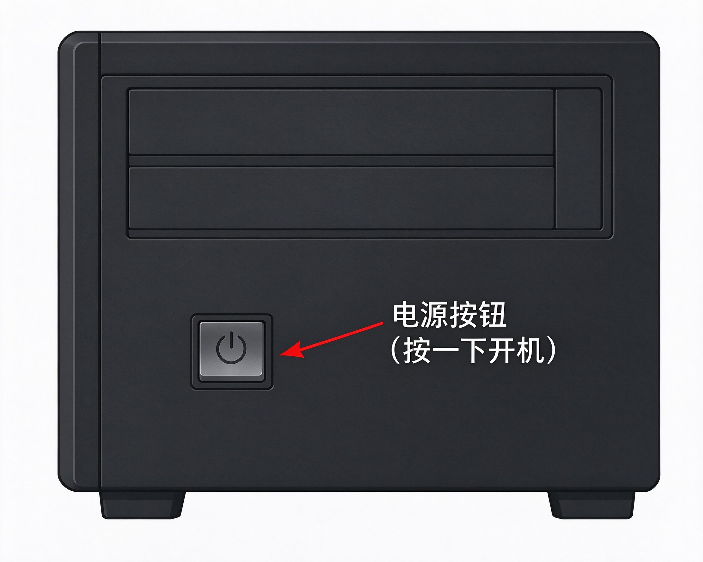
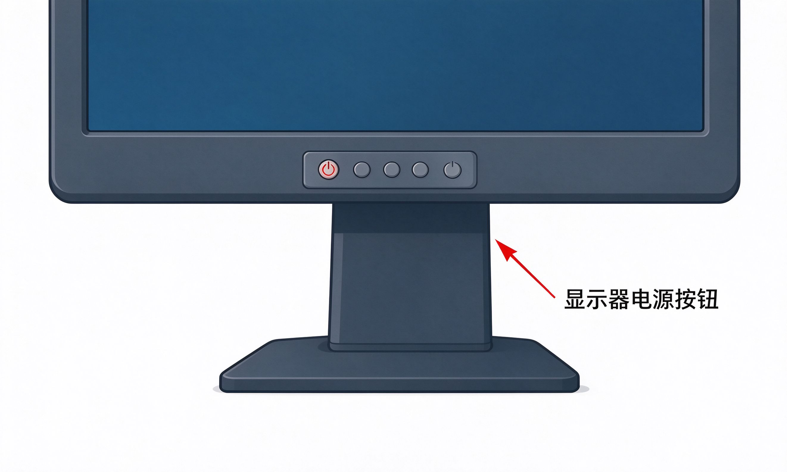

# 第1课：认识电脑的各个部件

一套台式电脑，主要由四个东西组成。先认清楚哪个是哪个，后面才不会搞混。

---

## 主机

那个比较大的黑色方盒子，就是 **主机**。

它是电脑的"大脑"——所有计算、存储都在里面。你平时不用打开它的盖子，里面是密密麻麻的零件，认识外面就行。

### 电源按钮在哪

主机正面或者上面，有一个最大的按钮，上面有个圆圈一竖的标志，那就是 **电源按钮**。

按一下它，电脑就开机了。

> [!note] 主机后面的线
> 主机后面有很多根线，插着电源、显示器、键盘、鼠标。这些线**不要随便拔**，认识就行。插回去的时候容易插错，到时候叫人帮忙。

---

## 显示器

就是那个屏幕，跟家里的电视差不多大。

电脑工作的画面都显示在这里。

### 显示器也要开机

很多人第一次用电脑会犯一个错：只开了主机，忘了开显示器。

显示器底部有一排小按钮，最左边那个带电源标志的，就是显示器的开关。

> [!tip] 怎么判断显示器开没开
> 显示器开着的时候，按钮旁边有个小灯是亮的。灯不亮就是没开。

---

## 键盘

跟打字机的键盘差不多，一排一排的按键。

用来输入文字、数字。后面会专门讲怎么用键盘。

现在只要知道：打字靠它。

---

## 鼠标

那个拿在手里、可以移动的小设备。

它是你指挥电脑的工具——移动光标、选择东西、点按钮，全靠它。后面会专门讲鼠标的用法。

现在只要知道：点东西靠它。

---

## 电源线

每样东西都需要插电：
- 主机有一根电源线
- 显示器有一根电源线
- 都插在墙上的插座或者插线板上

> [!warning] 不要乱拔线
> 主机后面的线很多，每根都插在固定的位置。认识就好，不要拔下来试——插回去的时候容易插错。

---

## 小练习

看着你面前的电脑，说出：

1. 主机在哪里？
2. 显示器在哪里？
3. 键盘在哪里？
4. 鼠标在哪里？

四个都指对了，这一节就过了。

---

**下一节：开机和关机**
