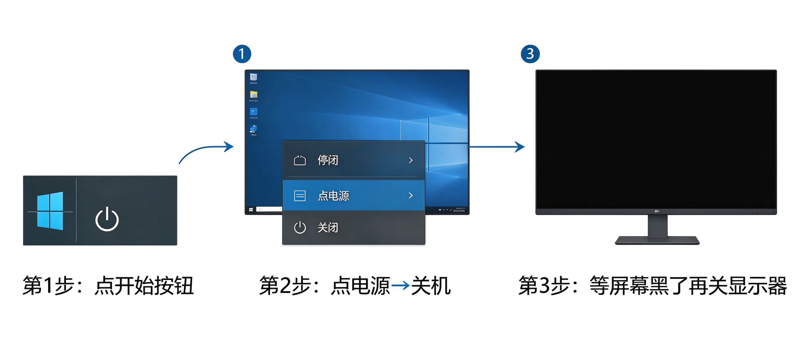

# 第2课：开机和关机

## 开机

找到主机上的电源按钮，按一下。

电源按钮一般在主机正面或者上面，是最大的那个按钮，上面有个圆圈一竖的标志。

### 开机过程中会发生什么

按完按钮之后，耐心等，不要反复按：

1. 屏幕先黑着，什么都没有
2. 然后出现电脑品牌的标志（比如联想、戴尔、华为的logo）
3. 接着出现一个转圈的加载画面
4. 最后进入桌面

整个过程大概半分钟到一分钟。

> [!note] 显示器也要开
> 如果主机开了但屏幕一直黑，先看显示器的电源灯亮不亮。没亮的话按一下显示器上的电源按钮。

---

## 登录

如果你的电脑设置了密码，会出现一个登录界面。

在输入框里输入密码，按回车键，就能进入系统。

如果开机后直接进入桌面，说明没有密码，跳过这一步。

> [!tip] 密码输错了怎么办
> 没关系，重新输就行。输错三次也不会锁电脑，放心输。

---

## 关机

用完电脑后，不要直接拔电源，也不要直接按主机电源键。正确的关机方式分三步：

1. 点击左下角 **开始按钮**
2. 找到 **电源** 图标，点一下，选 **关机**
3. 等屏幕完全变黑，再关闭显示器电源

> [!warning] 为什么不能直接按电源键关机
> 直接按电源键 = 强制断电，就像看书的时候突然把书抢走。
> 这样做的后果：
> - 没保存的内容会丢失
> - 下次开机会变慢
> - 长期这样电脑容易出问题

### 关机后要等多久

屏幕变黑之后，主机里还会运转几秒钟，等它完全停了（声音消失、电源灯灭了），再关显示器。

---

## 小练习

1. 按主机电源键开机
2. 等进入桌面
3. 按正确步骤关机
4. 等屏幕黑了，关显示器电源

从头到尾走一遍，这一课就掌握了。

---

**下一节：认识Windows桌面**
