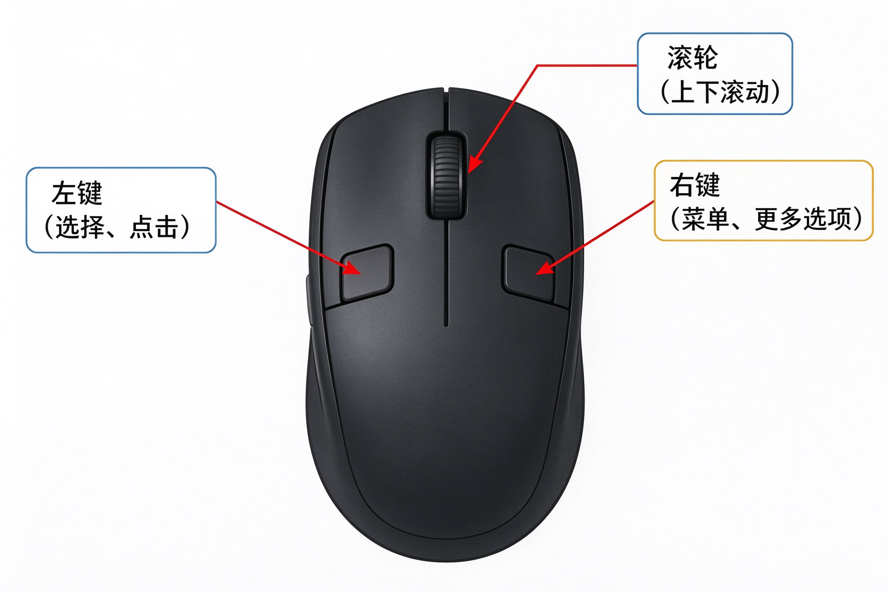

# 第2课：鼠标的基本用法

## 握鼠标

右手自然放在鼠标上，食指放在左键，中指放在右键，手腕贴在桌面上。

不用握得太紧，像握一只小鸟——太用力会累，太松会滑。

## 鼠标上有三个部位

### 左键

食指按的那个键，是用得最多的。

作用：
- **选择**：把光标移到一个图标上，按一下左键，这个图标就被选中了
- **点击**：按一下立刻松开，用来打开按钮、确认选项

### 右键

中指按的那个键。

作用：**弹出菜单**。在任何地方按一下右键，会弹出一个小菜单，里面是你对这个东西能做的操作。

刚开始不用管右键，等用熟了左键再慢慢试。

### 滚轮

中间那个可以滚动的轮子。

作用：**上下翻页**。网页或者文档太长看不完的时候，滚动滚轮就能上下移动画面。

## 两个基本动作

### 移动

手轻轻移动鼠标，屏幕上的箭头（叫"光标"）就跟着动。

注意：**不是拖动鼠标在垫子上擦**，而是手腕带动鼠标整体平移。鼠标拿起来再放下，光标不会动。

### 单击

食指按一下左键，立刻松开。

这是电脑上最常用的动作——选东西、点按钮、确认操作，全靠它。

> [!tip] 练习一下
> 在桌面上移动鼠标，让光标分别指向：
> 1. 左下角的开始按钮
> 2. 右下角的时间
> 3. 桌面上随便一个图标
>
> 指到了就按一下左键，看看有什么反应。

---

**下一节：打开和关闭程序**
