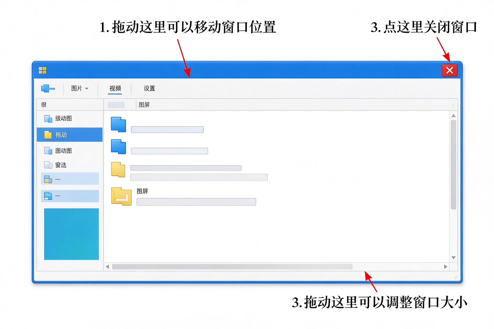

# 第5课：认识窗口——移动和调整大小

程序打开后出现的那个长方形画面，就叫 **窗口**。

你可以把窗口想象成一张"纸"——放在桌面上，可以移动位置，可以拉大缩小，看完了可以拿走。

---

## 窗口最上面那一条叫标题栏

窗口最顶部那一条横条，叫 **标题栏**。

左边写着这个程序的名字，右边有三个小按钮：最小化、最大化、关闭。

---

## 怎么移动窗口

把鼠标移到窗口**最上面那一条标题栏**上，按住左键不放，拖动鼠标，窗口就跟着移动了。

移到你想放的位置，松开鼠标左键就行。

> [!tip] 就像拖动一张纸
> 移动窗口跟你用手在桌上推一张纸是一个道理——按住、拖动、松开。

---

## 怎么调整窗口大小

把鼠标移到窗口**的边缘或者角上**，鼠标箭头会变成双向箭头。这时候按住左键拖动，就能把窗口拉大或者缩小。

四个角拖起来最方便，可以同时调整宽和高。

> [!note] 注意看鼠标箭头变化
> 只有箭头变成双向箭头的时候，才能调整大小。箭头还是普通箭头的时候，是拖不动的。

---

## 怎么关闭窗口

点窗口右上角那个 **叉号（X）**，窗口就关了，程序退出。

用完程序记得关，不要让窗口开着堆满整个屏幕。

---

## 小练习

1. 打开开始菜单，找到并打开"计算器"
2. 把鼠标移到窗口顶部标题栏，按住左键拖动，把窗口移到屏幕中间
3. 把鼠标移到窗口右下角，等箭头变成双向后，拖动调整大小
4. 点叉号关闭

四个步骤都做完，窗口的基本操作就掌握了。

---

**下一节：认识键盘**
