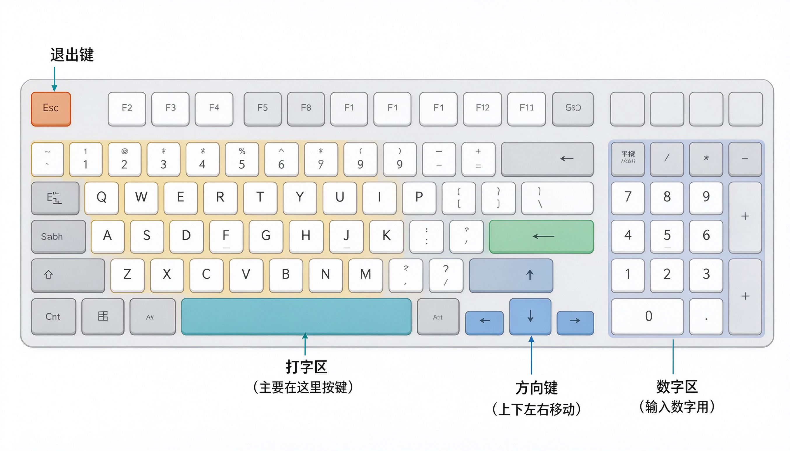

# 第6课：认识键盘

键盘上有很多按键，看起来密密麻麻，其实分几个区域，认识了就不会乱。

---

## 键盘的五个区域

### 打字区（中间最大的那一块）

这是最常用的区域，26个字母、数字、常用符号都在这里。

我们平时打字、输入文字，主要用这一块。

### 空格键（最下面最长的那个键）

按一下空一格。打字的时候，字和字之间的空隙就是靠它打出来的。

它在键盘最下面正中间，是最长的一个键，很好找。

### 数字小键盘（最右边）

如果你的键盘右边有一排数字键，那就是数字小键盘。

输入大量数字的时候用它比较快。刚开始不用管它。

### 方向键（小键盘左边，四个箭头）

四个箭头分别是上、下、左、右。

作用是移动光标——在文档里上下左右移动位置。

### 退出键（Esc，左上角第一个键）

按一下 Esc，通常是"取消"或者"返回上一步"的意思。

如果点错了想退出来，按它就行。

---

## 三个必须记住的特殊键

### 回车键（Enter）

上面有个拐弯箭头的标志，一般在打字区右边。

作用：**确认、换行**。
- 输入完密码，按一下它确认
- 写文字的时候，按一下它换到下一行

### 退格键（Backspace）

上面写着 Backspace，或者画着一个向左的箭头。

作用：**删掉打错的字**。打错了就按它，删掉光标前面那个字。

### 大小写锁定键（Caps Lock）

在键盘左边，按一下，右上角的指示灯会亮。

这时候打出来的字母都是大写。再按一下，灯灭了，变回小写。

> [!tip] 什么时候用大写
> 一般打字都是小写，只有打英文名字、特殊符号的时候才用大写。刚开始不用管它，知道有这个键就行。

---

## 小练习：找一找

看着你的键盘，不用按，先找到这些键的位置：

1. 空格键在哪里？
2. 回车键在哪里？
3. 退格键在哪里？
4. 四个方向键在哪里？
5. Esc 键在哪里？

五个都能找到位置，这一课就过了。

> [!note] 不用背位置
> 刚开始不用记住每个键在哪，用得多了自然就记住了。现在只要知道键盘分这几个区、几个常用键在哪就够了。

---

**下一节：打开和关闭程序**
