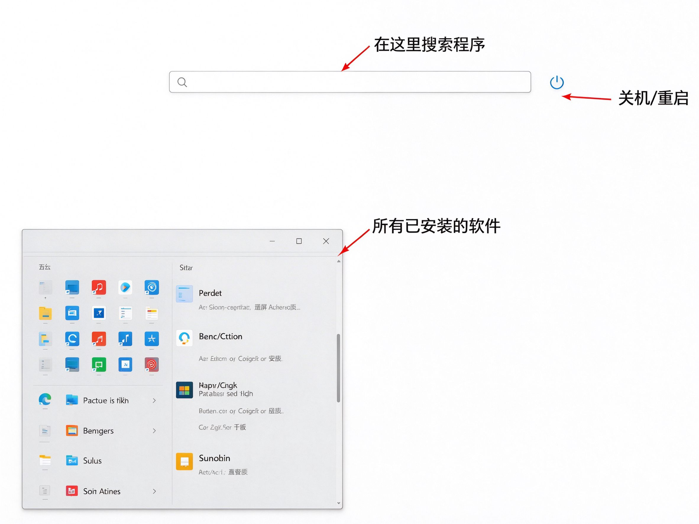
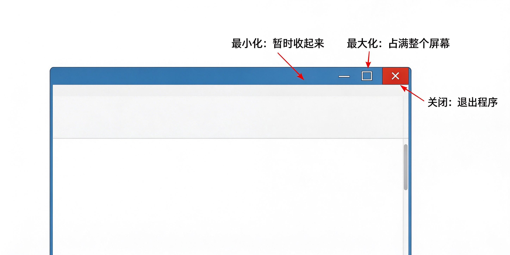

# 第7课：打开和关闭程序

## 什么是程序

程序就是电脑上的软件，比如浏览器、写字板、计算器。打开一个程序，就是启动一个软件来用。

## 从开始菜单打开程序

点击左下角的 **开始按钮**，会弹出一个面板。

在开始菜单里，你能看到一排应用图标。找到你要的那个，用鼠标左键点一下，就打开了。

> [!note] 搜索功能以后学
> 开始菜单顶部有个搜索框，学会打字以后用它找程序最快。现在我们先从列表里直接找。

## 窗口右上角的三个按钮

程序打开后，会出现一个长方形的画面，叫 **窗口**。窗口右上角有三个小按钮。

### 最小化（横线按钮）

点一下，窗口会暂时藏起来，缩到下面任务栏里。

程序并没有关闭，只是暂时看不见了。想再看的时候，点一下任务栏上对应的图标就行。

### 最大化（方框按钮）

点一下，窗口会占满整个屏幕，看得更清楚。

再点一下（这时候变成两个小方框），就变回原来的大小。

### 关闭（叉号按钮）

点一下，窗口就关闭了，程序退出。

> [!warning] 最小化和关闭不一样
> 最小化 = 把书暂时合上，还在桌上
> 关闭 = 把书放回书架，不用了

用完程序，记得点 **叉号** 关闭，不要直接关电脑。

## 练习一下

1. 点击左下角开始按钮
2. 在开始菜单里找到"计算器"，点一下打开
3. 点一下最大化按钮，看看窗口变大了
4. 再点一下变回原来大小
5. 点叉号关闭

做完这五步，这一节就掌握了。

---

**下一节：认识窗口——怎么移动和调整大小**
