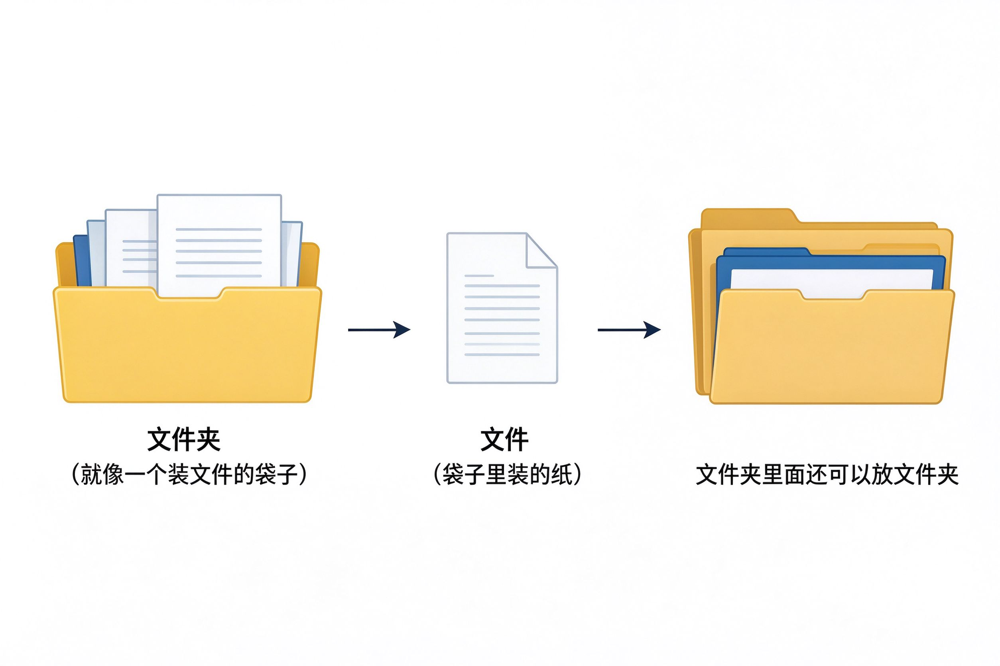

# 第8课：什么是文件和文件夹

电脑里所有的东西，都是以"文件"的形式存着的。就像你家里的纸和袋子。

---

## 什么是文件

文件就是电脑里的一份"东西"——可能是一篇文章、一张照片、一首歌、一个软件。

每个文件都有一个名字，就像每封信都有收件人。

> [!note] 常见的文件类型
> - 文档：写的文章、报告
> - 图片：照片、截图
> - 视频：录像、电影
> - 音乐：歌曲、录音

---

## 什么是文件夹

文件夹就是装文件的"袋子"。

一个文件夹里可以放很多文件，也可以放其他文件夹（就像袋子里还可以再装小袋子）。

用文件夹分类，电脑里的东西才不会乱。就像你家里：
- 一个袋子装电费单、水费单
- 一个袋子装照片
- 一个袋子装说明书

---

## 为什么要学文件操作

你以后会遇到这些情况：
- 微信收到一张照片，想存到电脑里
- 写了一份文档，想发给别人
- 电脑里东西太多，想整理一下
- 不小心删了文件，想找回来

这些都需要会操作文件和文件夹。

---

## 小练习

看着你的电脑桌面，找一找：

1. 桌面上有没有文件夹图标？
2. 桌面上有没有文件图标？
3. 它们长得一样吗？

不用打开，先认出来就行。

---

**下一节：打开文件资源管理器**
