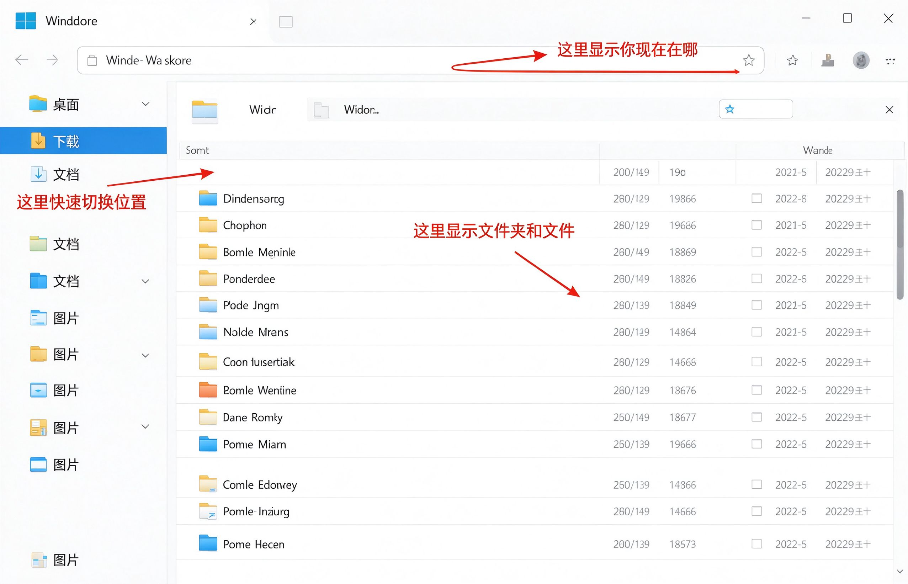

# 第9课：打开文件资源管理器

电脑里的文件和文件夹，都放在一个叫 **文件资源管理器** 的地方。就像你家里的文件柜，所有文件都在里面。

---

## 怎么打开它

方法很简单：点击左下角开始按钮，找到并打开 **文件资源管理器**（图标像一个黄色文件夹）。

打开后你会看到一个窗口，左边一列，右边一片。

---

## 窗口的三个部分

### 左侧导航栏

这里有几个常用位置，点一下就能跳过去：
- **桌面**：就是你开机看到的那个桌面
- **下载**：从网上下载的东西默认存在这里
- **文档**：写的文档一般存在这里
- **图片**：照片、截图存在这里

### 中间文件列表

这里显示当前位置下的所有文件夹和文件。

黄色的图标是文件夹，其他图标是文件。

### 顶部地址栏

这里显示你现在在哪个位置。就像手机地图上的"你在这里"。

---

## 小练习

1. 打开开始菜单，打开文件资源管理器
2. 点左边的"桌面"，看看右边显示什么
3. 点左边的"下载"，看看右边显示什么
4. 点左边的"文档"，看看右边显示什么

点三个位置就够了，感受一下左右两边的变化。

---

**下一节：新建和重命名文件**
