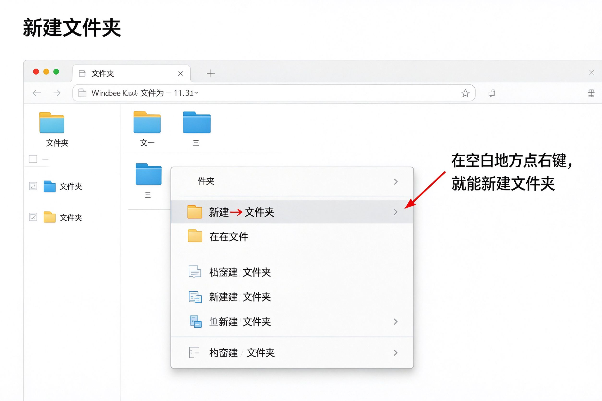

# 第10课：新建和重命名文件

## 怎么新建一个文件夹

在文件资源管理器里，找一个空白的地方，**点鼠标右键**，会弹出一个菜单。

1. 在空白处点右键
2. 选"新建"
3. 选"文件夹"
4. 这时候会出现一个新的文件夹，名字是蓝底的，可以直接打字命名

比如你可以建一个叫"我的照片"的文件夹，专门放照片。

---

## 怎么给文件改名字

如果一个文件夹或者文件的名字你想改：

1. 右键点这个文件
2. 选"重命名"
3. 名字变成蓝底，直接打字改成你想要的
4. 按回车键确认

> [!warning] 改名字注意
> 改名字的时候，不要把最后面的".docx"、".jpg"这些去掉。那些是文件类型，去掉了文件就打不开了。

---

## 小练习

1. 打开文件资源管理器，进入"桌面"
2. 在空白处点右键，新建一个文件夹
3. 给它起个名字，比如"练习文件夹"
4. 找到这个文件夹，右键→重命名，改成"我的练习"

做完这四步，新建和重命名就会了。

---

**下一节：复制和移动文件**
