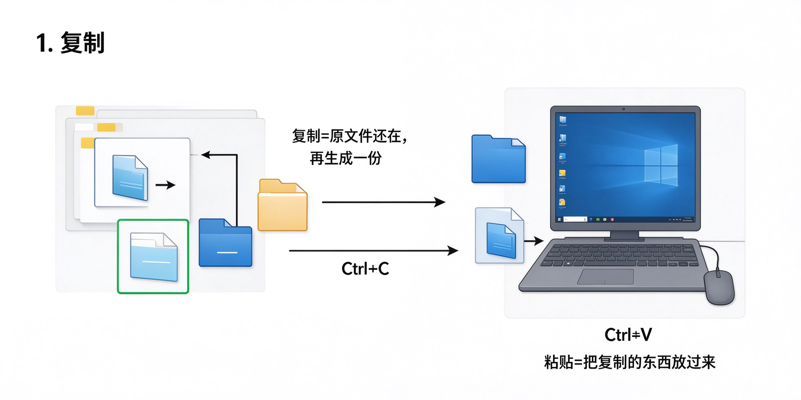

# 第11课：复制和移动文件

## 什么是复制

复制就是把一个文件"复印"一份——原来的文件还在，再生成一个一模一样的。

就像你复印一份身份证，原件还在你手里，复印件可以给别人。

---

## 怎么复制

1. 点一下选中你要复制的文件
2. 按键盘上的 **Ctrl + C**（按住Ctrl键不放，再按C键）
3. 打开你要复制到的那个文件夹
4. 按 **Ctrl + V**

就完成了。

> [!note] Ctrl+C 和 Ctrl+V 是什么意思
> - Ctrl+C = Copy（复制）
> - Ctrl+V = 粘贴
> 这两个快捷键在电脑里到处都能用，记住了以后很方便。

---

## 什么是移动

移动就是把文件从一个地方"搬"到另一个地方——原来的地方就没有了。

就像你把一本书从书架拿到书桌上，书架上就少了这本书。

### 怎么移动

最简单的方法：
1. 选中文件
2. 按 **Ctrl + X**（剪切，就是"剪下来"）
3. 打开目标文件夹
4. 按 **Ctrl + V**

---

## 复制和移动的区别

| 操作 | 原来的位置 | 目标位置 |
|---|---|---|
| 复制 | 还在 | 多了一份 |
| 移动 | 没了 | 多了一份 |

---

## 小练习

1. 在桌面上新建一个叫"练习"的文件夹
2. 找到桌面上任意一个文件，复制一份到这个文件夹里
3. 再把这个文件移动一下位置

感受一下复制和移动的区别。

---

**下一节：删除和恢复文件**
