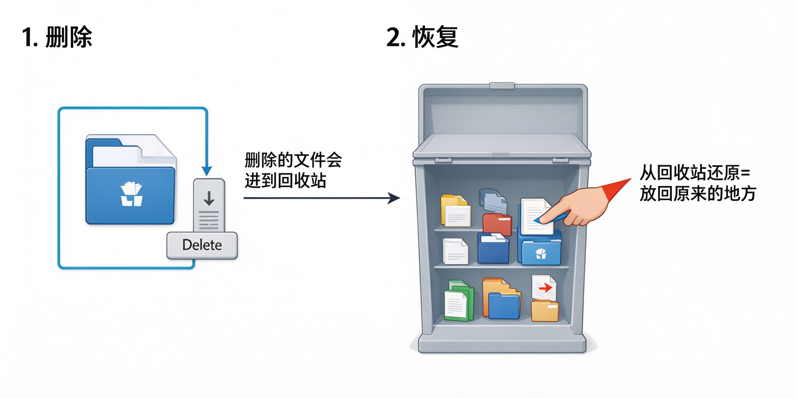

# 第12课：删除和恢复文件

## 怎么删除文件

选中你不要的文件，按键盘上的 **Delete** 键，就删除了。

但是别担心——删除的文件不是真的没了，而是进到了 **回收站**。

就像你把废纸扔进书桌旁边的废纸篓，不是扔到外面垃圾桶，想找还能找回来。

---

## 怎么恢复误删的文件

如果不小心删错了东西，别慌：

1. 打开桌面上的 **回收站** 图标
2. 找到你误删的文件
3. 右键点它，选"还原"
4. 文件就回到原来的地方了

> [!warning] 回收站清空了就找不回来了
> 如果你把回收站也清空了，文件就真的删了。所以删重要文件的时候要想清楚。

---

## 小练习

1. 在桌面上新建一个叫"待删除"的文件夹
2. 按 Delete 键删除它
3. 打开回收站，找到它
4. 右键→还原，把它找回来

感受一下删除和恢复的过程。

---

**第二阶段完。下一个阶段：上网与搜索**
