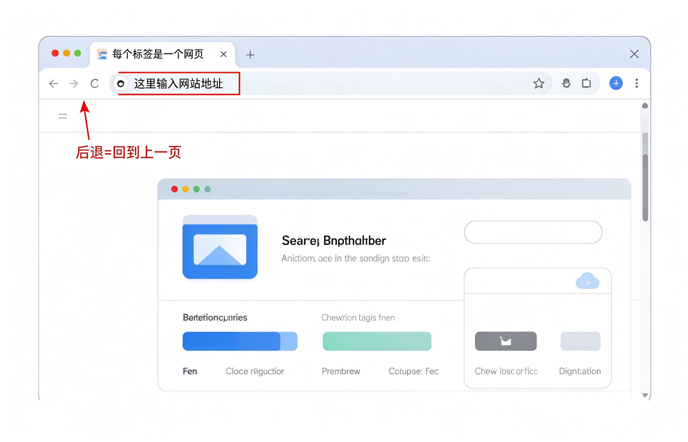

# 第13课：认识浏览器

浏览器就是用来上网看网页的软件。就像你家里的电视机——有了它才能看节目。

Windows 电脑自带的浏览器叫 **Edge**，一般在任务栏上就能找到。

---

## 浏览器的三个重要部分

### 地址栏

最上面那一条空白的长条，就是地址栏。

你想打开哪个网站，就把网站地址输在这里，按回车键，就能打开了。

### 标签页

地址栏上面那一排小标签，每个标签代表一个打开的网页。

就像你同时摊开了好几份报纸，想看哪份点哪个标签。

### 前进后退按钮

地址栏左边有两个箭头：
- **向左的箭头** = 后退，回到上一页
- **向右的箭头** = 前进，去下一页

点错了网页，点后退就回来了。

---

## 小练习

1. 打开浏览器
2. 看看地址栏在哪里
3. 点一下后退按钮，看看有什么反应
4. 看看上面有几个标签页

不用输入任何网址，先认识一下界面就行。

---

**下一节：怎么打开一个网站**
