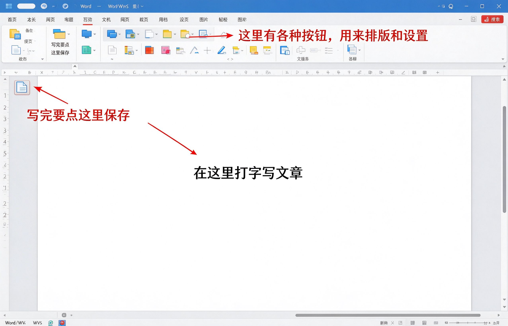

# 第17课：认识文字处理软件

Word 和 WPS 文字，都是用来写文章、写报告、写信的软件。它们的用法几乎一样，你电脑上装的是哪个就用哪个。

---

## 怎么打开它

点击开始菜单，找到 **Word** 或者 **WPS**，点一下打开。

打开后会看到一个空白的页面，就像一张白纸，等着写字。

---

## 界面的三个部分

### 中间空白区域

这就是你写字的地方。点一下鼠标，出现一个一闪一闪的竖线（叫"光标"），就可以开始打字了。

### 顶部工具栏

上面有很多按钮，用来设置字体大小、加粗、对齐方式等等。刚开始不用管它们，先会打字再说。

### 保存按钮

左上角那个像软盘一样的图标，就是 **保存**。

> [!warning] 一定要记得保存
> 打完字一定要点保存，不然关掉软件字就白打了。
> 建议打一段就保存一次，不要等到最后才存。

---

## 小练习

1. 打开 Word 或者 WPS
2. 在空白页面上随便打几个字
3. 点左上角的保存按钮
4. 给文件起个名字，点保存

知道怎么打开、打字、保存，这一课就会了。

---

**下一节：写一篇简单文档**
