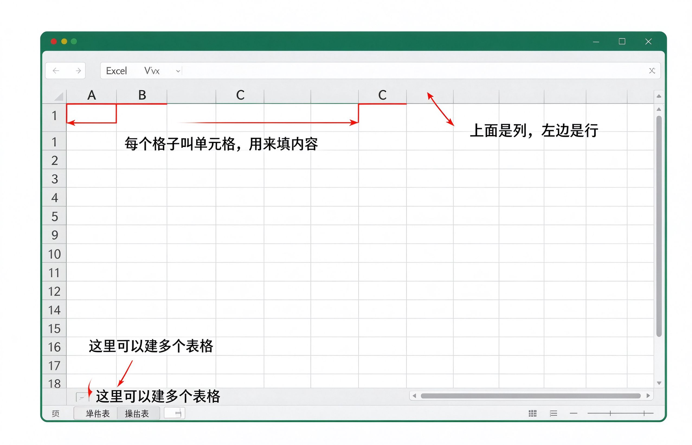

# 第19课：认识表格软件

Excel 和 WPS 表格，是用来做表格、算账、列清单的软件。就像你家里的记账本、购物清单表。

---

## 表格长什么样

打开后你会看到很多小格子，密密麻麻排成一片。

- 上面的 A、B、C 是 **列**（竖排的）
- 左边的 1、2、3 是 **行**（横排的）
- 每个小格子叫 **单元格**，就是你填内容的地方

---

## 怎么在格子里填东西

1. 用鼠标点一下你想填的格子
2. 直接打字，内容就填进去了
3. 按回车键，跳到下一个格子

比如做一个购物清单：
- A1 格子填"要买什么"
- B1 格子填"多少钱"
- A2 格子填"大米"
- B2 格子填"50元"

就像在纸上画表格填内容一样。

---

## 小练习

1. 打开 Excel 或者 WPS 表格
2. 在 A1 格子里输入"购物清单"
3. 在 A2 输入"大米"，B2 输入"50"
4. 在 A3 输入"面粉"，B3 输入"20"
5. 保存文件到桌面

填三行内容，表格就入门了。

---

**下一节：打印文件**
